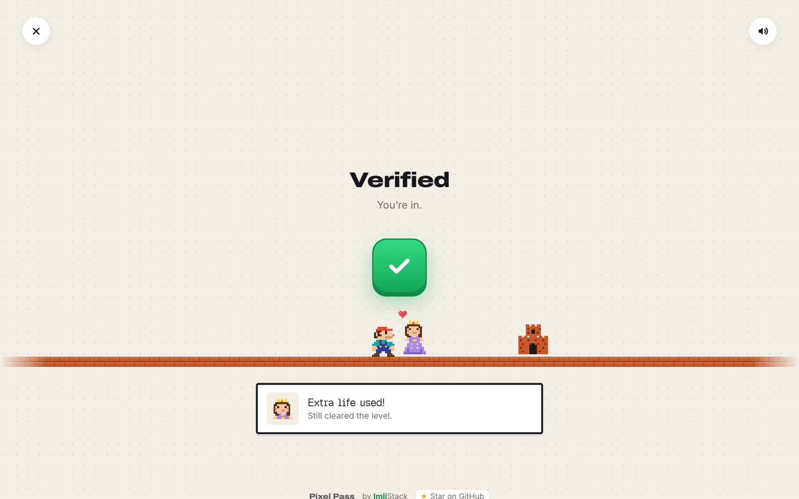
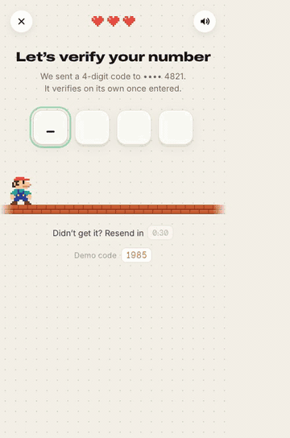
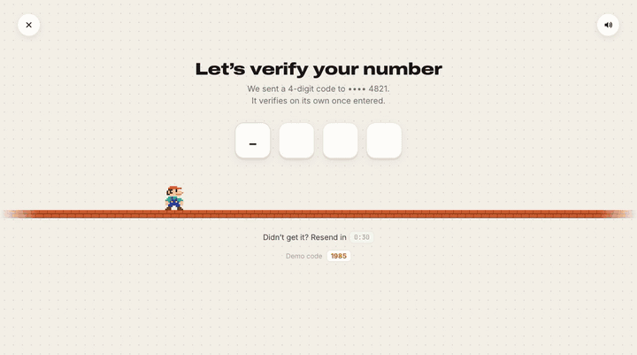
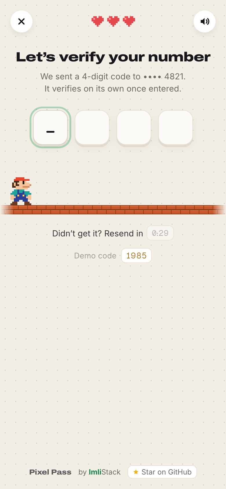
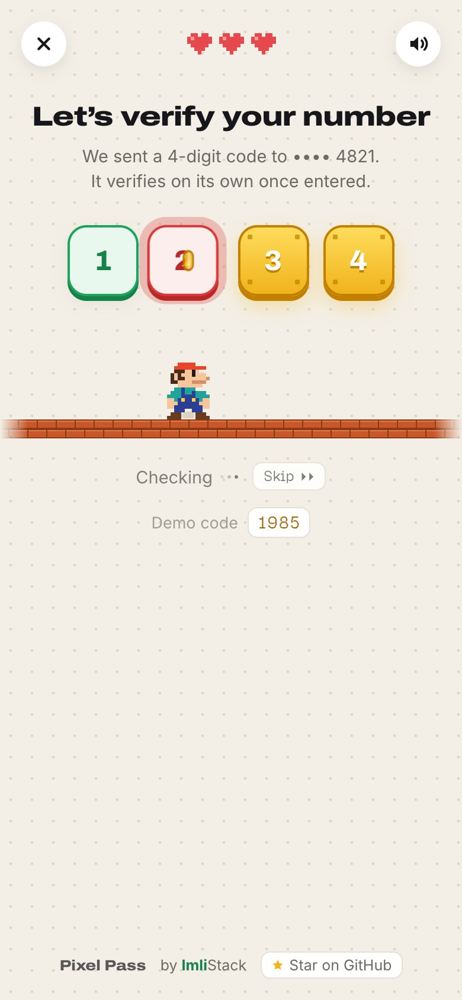
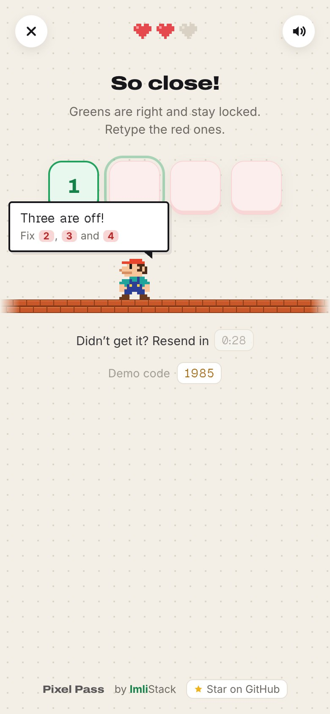
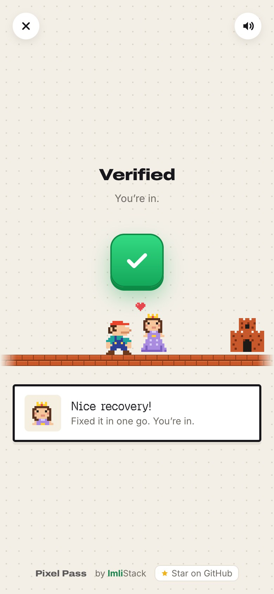
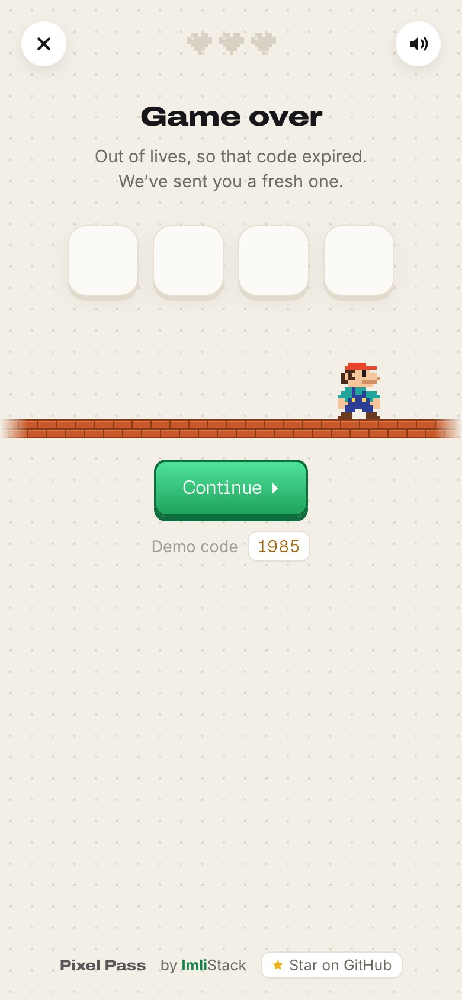

<div align="center">


# Pixel Pass

**A 4-digit OTP verification screen that plays like a tiny 8-bit platformer.**

Type the code and a pixel hero runs under each digit and bumps it like a block. A coin pops out and the
block turns green if the digit is right, red if it's wrong. Greens lock in place, so you only retype the
red ones. Get all four and the blocks merge into a big green check, a castle slides in and the toast
cheers you on: *"Level clear! One retry, and you're in."*

### [▶ Try the live demo](https://pixel-pass.imlistack.workers.dev) &nbsp;·&nbsp; demo code `1985`

[](https://react.dev)
[](https://www.typescriptlang.org)
[](https://motion.dev)
[](https://vitejs.dev)
[](#-how-it-works)
[](#-how-it-works)
[](https://pixel-pass.imlistack.workers.dev)

[Demo](#-demo) · [The flow](#-the-flow) · [Features](#-features) · [Quick start](#-quick-start) · [How it works](#-how-it-works) · [Project structure](#-project-structure) · [Roadmap](#-roadmap)

<br />



</div>

<br />

## ✦ Demo

<div align="center">
<table>
  <tr>
    <td width="38%" align="center"></td>
    <td width="62%" align="center"></td>
  </tr>
  <tr>
    <td align="center"><sub><b>Phone</b> · 17 s · <a href="docs/demo-mobile.mp4">MP4</a></sub></td>
    <td align="center"><sub><b>Desktop</b> · 19 s · <a href="docs/demo.mp4">MP4</a></sub></td>
  </tr>
</table>
<sub>Recorded with <code>npm run demo</code>: wrong code <code>1234</code> → "Three are off!" → retype <code>985</code> → verified</sub>
</div>

## ✦ The flow

<table>
  <tr>
    <td width="20%"></td>
    <td width="20%"></td>
    <td width="20%"></td>
    <td width="20%"></td>
    <td width="20%"></td>
  </tr>
  <tr>
    <td align="center"><sub><b>1 · Enter</b><br />4 key-cap slots, resend timer, demo code</sub></td>
    <td align="center"><sub><b>2 · Check</b><br />hero bumps each block, coin, green or red</sub></td>
    <td align="center"><sub><b>3 · So close!</b><br />greens lock, retype only the reds</sub></td>
    <td align="center"><sub><b>4 · Verified</b><br />merge, ✓, castle, heart, toast</sub></td>
    <td align="center"><sub><b>Game over</b><br />3 wrong tries → fresh code</sub></td>
  </tr>
</table>

| Phase | What happens |
|---|---|
| `input` | *Let's verify your number*. Three pixel hearts sit in the header. Slots fill as you type; the active one blinks `_` and the hero walks under it, hopping as each digit lands. Paste and SMS autofill (`autocomplete="one-time-code"`) work. *Didn't get it? Resend in 0:29* counts down. |
| `checking` | The 4th digit submits on its own. Footer shows *Checking ···* and a **Skip ▸▸** button that fast-forwards the animation. Slots turn into gold blocks; the hero runs under each one and jumps; the block bumps, a coin pops and it turns **green** or **red**; red blocks shake and flash. A puff of dust marks every landing. |
| `failed` | Title becomes *So close!*. A speech bubble over the hero says *Three are off! Fix ② ③ and ④*. Red slots clear (with a pink hint), the cursor jumps to the first one and **one heart is lost**. |
| `checking` (retry) | Only the retyped slots are re-checked; locked greens are skipped. |
| `gameover` | After 3 wrong tries: *Game over*. The old code is void, even the greens clear, and **Continue ▸** starts again with a fresh code and full hearts. This is the rate limit, shown as a game rule. |
| `merging` | All green: the four slots slide into one gold `?` block, the hero bumps it and it turns green. |
| `verified` | *Verified · You're in.* A big ✓ with a pulse ring and a coin burst. A castle slides in, the princess walks out, a heart pops, and a toast types out a random line for how many tries it took, never the same twice in a row: e.g. **Perfect run!** / **Speedrun!** (first try), **Level clear!** / **Extra life used!** (one retry), **Persistence pays!** / **Never game over!** (more). |

## ✦ Features

- **Game-feel OTP input**: run, jump, bump, coin, reveal — each digit is its own tiny level.
- **Partial retry**: correct digits stay locked; only wrong ones need retyping.
- **Lives as the rate limit**: 3 hearts; running out voids the code and sends a new one, so per-digit hints can't be brute-forced.
- **A hero with anticipation**: walks under the slot you're typing in, hops when a digit lands, blinks while idle; wrong blocks shake and flash red.
- **Full-page and responsive**: phone, tablet and desktop. The brick ground runs edge to edge; the hero and castle stay near the action on wide screens.
- **Chiptune sound effects** synthesised live with WebAudio (type, jump, bump, coin, wrong, fanfare, heart). No audio files. Mute toggle top-right.
- **Original pixel art**, drawn from string grids into crisp SVG. No image files at all, so it stays sharp at any size.
- **Real input handling**: one hidden native input catches typing, backspace, paste and iOS/Android SMS autofill.
- **Resend countdown**, demo code chip, close button to restart.
- **Accessible**: screen readers hear each result ("Three are off! Fix digits 2, 3 and 4. 2 lives left."), a Skip button fast-forwards any check, `prefers-reduced-motion` makes it near-instant, and the active slot shows a focus ring.
- **Type**: Archivo Expanded for headings, Inter for body, and **Geist Pixel** only for game text (chips, bubble, toast, `?` block). All fonts are self-hosted: no third-party requests.

## ✦ Quick start

> **Requires** Node.js 18+ (22+ for deploying with Wrangler). Google Chrome and FFmpeg only for recording the demo.

```bash
git clone https://github.com/ImliStack/Pixel-Pass.git "Pixel Pass"
cd "Pixel Pass"
npm ci
npm run dev                 # → http://localhost:5178
```

Enter **1985** to verify, or anything else to see the retry flow.

| Script | What it does |
|---|---|
| `npm run dev` | Vite dev server on port 5178 |
| `npm run build` | Type-check and build to `dist/` |
| `npm run preview` | Serve the production build |
| `npm run demo` | Record desktop + phone runs → `docs/demo*.mp4`, `docs/demo*.gif`, `docs/screenshots/`, `public/og.jpg` |
| `npm run deploy` | Build and deploy `dist/` to Cloudflare Workers static assets (`wrangler.toml`) |

To use your own verification API, replace `verifyDigits()` in [`src/lib/verify.ts`](src/lib/verify.ts). It takes the four digits and returns which ones are right.

## ✦ How it works

1. **State machine.** [`otpMachine.ts`](src/machine/otpMachine.ts) is a pure reducer — phases `input → checking → failed | merging → verified` and events like `TYPE`, `REVEAL`, `CHECK_FAILED`. No timers or DOM, so it ports straight to a Flutter Cubit.
2. **Director.** [`useOtpFlow.ts`](src/machine/useOtpFlow.ts) runs the timeline: it measures each slot's position, runs the hero there, jumps, and dispatches `REVEAL` at the top of the jump. Every step awaits a cancellable token, so the close button stops any animation mid-flight.
3. **Sprites.** [`sprites/data.ts`](src/sprites/data.ts) holds the hero, princess, castle and heart as string grids plus palettes. [`PixelSprite`](src/sprites/PixelSprite.tsx) merges runs of one colour into SVG rects with `crispEdges`.
4. **Motion.** Framer Motion springs for slot bumps, the merge, the check block and the toast; CSS for the cursor, dots and brick ground.
5. **Sound.** [`sound.ts`](src/lib/sound.ts) plays square- and triangle-wave notes through WebAudio.

The frame-by-frame breakdown of the reference video, timings and Flutter port notes are in [ARCHITECTURE.md](ARCHITECTURE.md).

> **Security note.** Telling a user *which* digits are right makes a 4-digit code guessable in at most 40 tries instead of 10,000. Use per-digit feedback in demos, or behind strict rate limits and short code lifetimes.

## ✦ Project structure

```
src/theme/            tokens.css (colours, type, radii) · global.css (paper background, responsive sizes)
src/machine/          otpMachine.ts (pure state machine) · useOtpFlow.ts (choreography + hero motion)
src/components/       OtpSlots, CheckBlock, Stage (hero, coins, bubble, castle, princess, ground), Chrome (header, heading, footer, toast, credit)
src/sprites/          pixel grids + PixelSprite renderer
src/lib/              verify.ts (mock API, demo code) · sound.ts (WebAudio SFX)
tools/demo.mjs        Playwright + Chrome screencast → MP4, GIF, screenshots
docs/                 logo, demo media, screenshots
```

## ✦ Roadmap

- [x] Web version matching the reference video, frame by frame
- [x] Full-page responsive layout, sound, paste and SMS autofill
- [x] Demo recorder, README media, Cloudflare deploy config
- [x] Lives, game over, random toasts, shake and dust, idle hero, skip, screen-reader narration, pixel game font
- [ ] Haptics, shareable run card, resend power-up, night level (see [docs/UI-RESEARCH.md](docs/UI-RESEARCH.md))
- [ ] More 90s-game-style auth screens: arcade login, character-select signup, password-strength blocks, "save your game?" logout
- [ ] Flutter port using the same state machine and sprite grids
- [ ] Haptics on mobile, optional background chiptune

## ✦ Credits

- Built by [ImliStack](https://imlistack.com). Source: [github.com/ImliStack/Pixel-Pass](https://github.com/ImliStack/Pixel-Pass). A ⭐ helps.
- UX inspired by a short reference video of a game-style OTP screen. All pixel art, sounds and code here are original; no sprites or audio from any game were used.
- Fonts: Archivo, Inter and JetBrains Mono via Fontsource; Geist Pixel by Vercel × basement.studio. All SIL Open Font License 1.1.
- Built with React, Framer Motion, Vite and Playwright.
